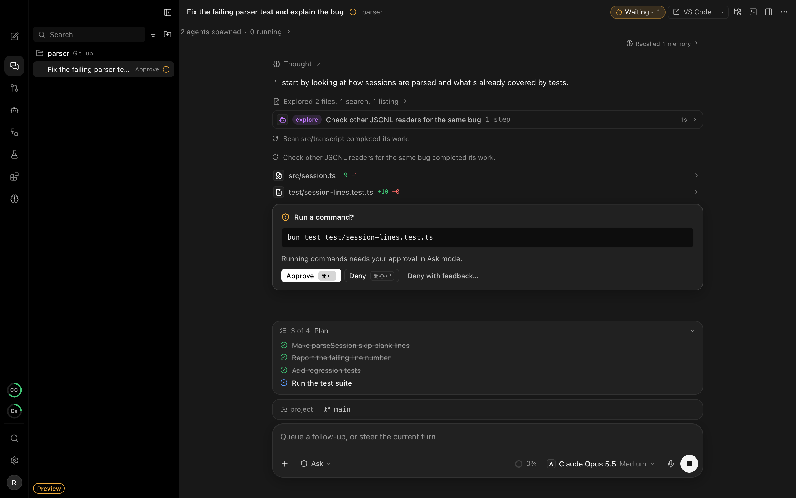

<p align="center">
  
</p>

<h1 align="center">Runrail Desktop</h1>

<p align="center"><b>A desktop cockpit for coding agents.</b><br>
Run Claude Code, Codex, GitHub Copilot, Pi, or Runrail's own agent on any model you connect -<br>
each thread in its own worktree, every command and edit behind your approval.</p>

<p align="center">
  <a href="https://github.com/TechDev009/runrail-desktop/actions/workflows/build.yml"></a>
  <a href="https://github.com/TechDev009/runrail-desktop/releases/latest"></a>
  
  <a href="LICENSE"></a>
</p>

<p align="center">
  <a href="#install">Install</a> ·
  <a href="docs/FEATURES.md">All features</a> ·
  <a href="https://github.com/TechDev009/runrail">Runrail engine</a> ·
  <a href="SECURITY.md">Security</a> ·
  <a href="CHANGELOG.md">Changelog</a>
</p>

<p align="center">
  
</p>

---

Runrail Desktop puts your coding agents in one window. Each thread runs on a local, supervised
[Runrail](https://github.com/TechDev009/runrail) engine: on Runrail's own agent loop with any
model you connect, or on Claude Code, Codex, GitHub Copilot, or Pi through their own sign-ins.

- **Every tool, one workflow.** Pick the model for each thread, from your connected providers
  or the coding tools you already pay for, and see each plan's usage beside the composer.
- **You approve what runs.** Plan, Ask, Auto-edit, or Full access, per thread. Approval cards
  show the exact command or file before anything happens.
- **Parallel by default.** Give a thread its own git worktree, run Best of N across models and
  tools, compare the diffs and check results side by side, and keep the winner.
- **Review and ship.** Stage, comment, and commit from the diff view. See every pull request
  waiting on you, its checks and reviews, and post or merge after you confirm.
- **Works while you're away.** Workflows on a schedule or a pull request event, notifications
  when a thread needs you, and a menu bar item that keeps work running after the window closes.
- **Local and private.** No account, no telemetry. Keys stay in the system keychain, and the
  window never holds a credential.

- **Start something new.** Create an app from a starter (Nifra, Vite, or Next.js) and open
  it as a project in one step.

The [feature guide](docs/FEATURES.md) covers everything area by area: threads, the composer,
reviews, worktrees, imports from other tools, voice, the side panel, workflows, the menu bar,
extensions, and the look.

## Install

Download the file for your system from the
[latest release](https://github.com/TechDev009/runrail-desktop/releases/latest).
`SHA256SUMS.txt` there lists each file's checksum.

| System | File |
|---|---|
| macOS 13 or later, Apple silicon | `Runrail_<version>_aarch64.dmg` |
| macOS 13 or later, Intel | `Runrail_<version>_x64.dmg` |
| Linux x64 or arm64 | `.deb`, `.rpm`, or `.AppImage`; see [docs/LINUX.md](docs/LINUX.md) |
| Windows 10 or later, x64 (experimental) | `Runrail_<version>_x64-setup.exe` or `.msi` |

These builds are not yet signed by a registered developer, so macOS and Windows warn before the
first launch:

- **macOS:** drag Runrail to Applications and open it. When macOS says it cannot verify the app,
  choose Done, then open System Settings, Privacy & Security, and click Open Anyway beside the
  message about Runrail. Or, in Terminal:

  ```bash
  xattr -dr com.apple.quarantine /Applications/Runrail.app
  ```

- **Windows:** when SmartScreen says it protected your PC, choose More info, then Run anyway.
- **Linux:** no warning; the packages are unsigned.

Runrail checks the latest release at launch and every six hours. An update downloads only when
you click Install and restart, and installs only if its signature matches the key built into
the app.

To work with Claude Code, Codex, GitHub Copilot, or Pi, install that tool and sign in to it
once; Runrail uses its login as it is. To use a model directly, connect a provider in
Settings with a key or a browser sign-in.

## Privacy

Runrail has no account and sends nothing to its authors. It talks only to:

- the model providers and coding tools you use, with your own sign-ins;
- npm, once, to fetch the Claude Agent SDK the first time a Claude Code thread needs it;
- GitHub, for the update check, and through your own `gh` sign-in for pull requests;
- Hugging Face, only if you download a Whisper model for local dictation;
- your phone's push service, only if you turn on phone notifications;
- npm, when you start a new app, to fetch that starter's creator at a fixed version.

Keys and sign-ins are kept in the system keychain (on Linux without a keyring, in a file only
your user can read). The app's own database stores which connection a thread uses, never a key
or token. See [SECURITY.md](SECURITY.md) for the trust boundaries.

## Nifra in Runrail

[Nifra](https://github.com/nifrajs/nifra) is a TypeScript framework made by the authors of Runrail,
and the Runrail engine is built on it. The app promotes Nifra in these places and nowhere else,
each in plain view and each with a way out:

| Where | What you see | Turn it off |
|---|---|---|
| Create project, New app | Nifra is the first starter, chosen by default and marked Recommended, with "By the authors of Runrail" on its card. Vite + React, Next.js, and Empty sit beside it with their makers. | pick another starter |
| Threads in a Nifra project | Runrail's own agent gets the tools of the `nifra mcp` on your PATH (docs, examples, and types without asking; anything else asks first), and Pi gets Nifra's instructions and tools. The thread header shows a **Nifra** label that says what was added; click it for the switch. | Settings, General, **Nifra in Nifra projects** |
| Settings, MCP servers | A line saying the Nifra server starts in Nifra projects, with a link to the switch. | the same switch |

A Nifra project is one that depends on Nifra or has a Nifra config file. Other projects get none of
this. Runrail never installs `nifra` for you and sends nothing about it anywhere. The engine's
[README](https://github.com/TechDev009/runrail#nifra-in-runrail) lists the same places for the
command line.

## Experimental

These pass their tests against stand-ins (a fake `gh`, mock services, a simulated host) but have
never run against the real thing. Expect rough edges, and
[report what breaks](https://github.com/TechDev009/runrail-desktop/issues):

- Posting pull request reviews and merging on real GitHub.
- An integration with a real connector key (Jira, Linear, Slack, and others).
- Phone access and access over a tailnet.
- Computer use with the real macOS permission prompts (Screen Recording and Accessibility).
- "Run schedules after Quit" from an installed build.
- Compaction in the real app.
- The Linux desktop: the tray, the keyring, and Wayland. With no keyring (no Secret Service on
  the session bus), keys and sign-ins are kept in a file vault that only your user can read, but
  in plain text, not encrypted.
- The Windows app. CI builds it, but it has never been run.
- The unofficial xAI, Kimi, and Meta plan sign-ins. Each is labelled Unofficial, presents that
  vendor's own command-line client id, and has never been run against the vendor.

## Build from source

You need [Bun](https://bun.sh) 1.3 or newer, Rust, and a
[Runrail](https://github.com/TechDev009/runrail) checkout beside this one. On macOS, local
dictation also needs `cmake` (`brew install cmake`) and Xcode's command line tools; Linux needs
the packages in [docs/LINUX.md](docs/LINUX.md).

```bash
bun install
bun run dev
```

`bun run dev` serves the UI on http://localhost:1420. In a plain browser it runs against a
scripted preview engine (marked **Preview** in the sidebar), so every screen can be exercised
without a model or credentials; the screenshot above comes from it.

For the native app, build the bundled engine from the sibling checkout (`RUNRAIL_DIR` points
elsewhere), then start Tauri:

```bash
bun run sidecar
```

```bash
bun run tauri dev
```

The sidecar is Runrail compiled without the Claude Agent SDK: the engine fetches the SDK version
`bun.lock` pins from npm the first time a Claude Code thread or usage read needs it, and runs the
`claude` you installed. The window is transparent so macOS can draw the sidebar material behind
it, which needs Tauri's `macOSPrivateApi` and keeps this build out of the Mac App Store.

### Test

```bash
bun run typecheck
bun test
cargo test --manifest-path src-tauri/Cargo.toml
```

`bun run e2e:native` drives the real app end to end: a debug build under its own identifier
(`com.runrail.desktop.e2e`) with a home folder of its own, so it needs no model and touches none
of your accounts. `--model-runs` adds a Best of 2 on Claude Code's Haiku, and `--setup-run` a
plan, execute, review setup run in a scratch repo; both use your Claude Code login.
`scripts/automation.ts` drives a debug build started with `RUNRAIL_AUTOMATION=1` by hand.

### Release

Every push and pull request runs [build.yml](.github/workflows/build.yml): typecheck and tests,
then the app for macOS (arm64 and x64), Linux (x64 and arm64), and Windows (x64), each with its
engine built from the [Runrail](https://github.com/TechDev009/runrail) checkout. macOS builds
go through `scripts/release.ts mac`, which signs the engine and the app with separate
entitlements so only the engine may JIT. A version tag collects every bundle, the signed update
feed, and checksums into a draft GitHub release that stays hidden until it is published by
hand. [docs/RELEASE.md](docs/RELEASE.md) has the steps, the signing secrets, and the updater
key.

## Contributing

Issues and pull requests are welcome; see [CONTRIBUTING.md](CONTRIBUTING.md). Report security
problems privately, as [SECURITY.md](SECURITY.md) describes.

## License

Free software under the GNU Affero General Public License, version 3 (AGPL-3.0-only; see
[LICENSE](LICENSE)), with an additional permission to combine it with Anthropic's Claude Agent
SDK (see [NOTICE](NOTICE)). You may use, modify, and redistribute it for any purpose, including
commercial work. If you distribute a modified version, or let others use one over a network, you
must offer them its source under the same license.
